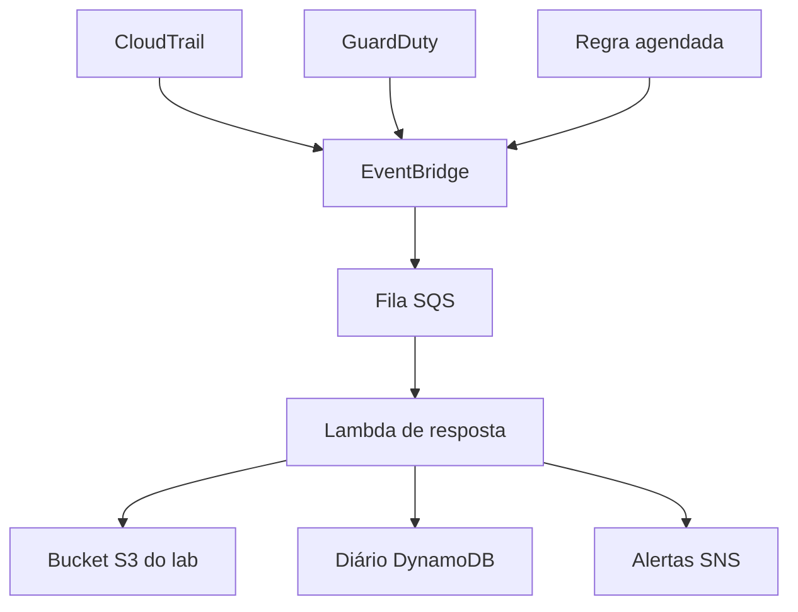

# Sentinela AWS

**Detecção, triagem e resposta automatizada a incidentes no Amazon S3.**

Projeto de portfólio em **Terraform e Python**. Uma alteração no S3 Block Public Access chega pelo CloudTrail. A automação confere o estado atual, registra a evidência e pode restaurar as quatro proteções do bucket do laboratório. Achados de possível exfiltração ou exclusão anômala chegam pelo GuardDuty e geram incidentes para triagem.

`AWS` · `Cloud Security` · `Incident Response` · `Terraform` · `Python 3.12` · `GitHub Actions`

## O que você consegue demonstrar

| Sinal | Decisão | Evidência |
| --- | --- | --- |
| Escrita ou exclusão da configuração de bloqueio no bucket do laboratório | Relê o S3. Em `observe`, registra o que faria. Em `enforce`, restaura e verifica as quatro opções. | Estado anterior, baseline, estado verificado e ID do CloudTrail. |
| Verificação agendada a cada cinco minutos | Confere o mesmo bucket e trata desvios que escaparam do fluxo de eventos. | Incidente quando há desvio. Verificações saudáveis ficam fora do diário. |
| Achado S3 do GuardDuty de um dos dois tipos selecionados, severidade ≥ 4 | Alerta para triagem. Uma alteração de acesso público seria insuficiente para conter, por exemplo, credenciais comprometidas. | ID, revisão, severidade e nomes normalizados dos buckets informados. |

## Arquitetura



A entrega do EventBridge e o processamento do Lambda têm filas de falhas separadas. Alarmes do CloudWatch acompanham as duas DLQs e a idade da fila principal. [Arquitetura detalhada](docs/architecture.md)

## Rode a demonstração local

Com Python 3.12, execute na raiz do projeto.

```bash
make demo
make test
```

Sem `make`, execute `PYTHONPATH=src:. python3 scripts/demo.py` em um terminal Bash. A demonstração reprocessa eventos sintéticos com o mesmo motor Python usado no Lambda e adaptadores em memória. A suíte padrão roda sem credenciais AWS. As três provas com SDK e serviços emulados são ativadas ao instalar as dependências de desenvolvimento.

| Caso reproduzido | Resultado | Escritas no bucket simulado |
| --- | --- | --- |
| Desvio em `observe` | `would_remediate` | 0 |
| Desvio em `enforce` | `remediated`, com as quatro opções em `true` | 1 |
| Reentrega do mesmo evento | `duplicate` | 0 adicionais |
| Possível exfiltração no GuardDuty | `triage_required` | 0 adicionais |

[Saída JSON gerada pela demonstração](docs/evidence/local-demo.json)

## Validação e DevSecOps

```bash
python3.12 -m venv .venv
source .venv/bin/activate
python -m pip install --require-hashes --only-binary=:all: -r requirements-dev.lock
make lint test
make validate
make scan
```

`make validate` requer Terraform 1.17.x e roda testes de plano com o provedor AWS simulado. `make scan` requer Trivy 0.76.2. O workflow executa esses controles em pull requests e na branch `main`. O job tem acesso de leitura ao código, usa ações fixadas por SHA e bloqueia segredos detectados no snapshot e achados IaC altos ou críticos. O workflow de CI dispensa credenciais e faz apenas validações. [Workflow](.github/workflows/ci.yml)

## Implante em uma conta sandbox

O Terraform inicia em `observe`. Em `enforce`, o IAM permite a escrita somente no ARN do bucket criado pela stack. O exercício verifica a conta AWS, o bloqueio de conta, a ausência de objetos e o estado do bucket antes de aplicar um desvio controlado. O laboratório pode gerar custos na AWS. [Implantação, exercício e remoção](docs/lab-aws.md)

## Estrutura do repositório

| Caminho | Conteúdo |
| --- | --- |
| `infra/` | Stack Terraform, exemplo de variáveis, lock de provedores e testes de plano. |
| `src/sentinela/` | Normalização dos eventos, catálogo de detecção, fluxo de resposta e adaptadores AWS. |
| `tests/` | Testes Python, serviços emulados e eventos sintéticos. |
| `scripts/` | Demonstração offline e exercício controlado na AWS. |
| `docs/` | Arquitetura, modelo de ameaças, runbook, implantação, evidência e guia de publicação. |
| `.github/workflows/ci.yml` | Validação automatizada e análise de segurança. |

## Documentação

- Fluxo de dados, decisões de resposta e semântica das reentregas. [Arquitetura](docs/architecture.md)
- Superfícies de ataque, controles e limites do laboratório. [Modelo de ameaças](docs/threat-model.md)
- Triagem, alarmes, investigação e reprocessamento. [Runbook de incidentes](docs/runbook.md)
- Comandos para criar o repositório e subir o código. [Publicação no GitHub](docs/github.md)
- Termos para reutilização do código. [Licença MIT](LICENSE)
