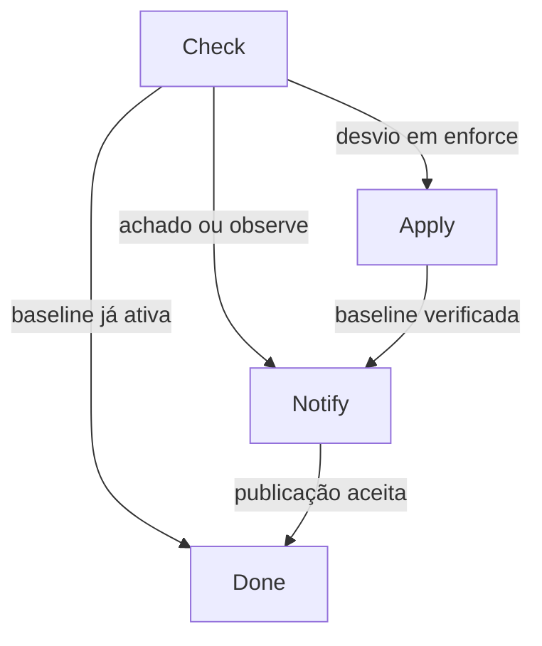

# Arquitetura do Sentinela AWS

A stack opera em uma conta e uma região AWS comercial. O Terraform cria um bucket dedicado e vazio, o worker e os controles de entrega. A trilha CloudTrail e o detector GuardDuty podem ser reaproveitados. A gravação corretiva tem como destino fixo o bucket criado pela stack.

## Contrato de detecção

| Origem | Filtro | Chave do incidente |
| --- | --- | --- |
| CloudTrail no barramento padrão | `aws.s3`, operação `PutBucketPublicAccessBlock` ou `DeleteBucketPublicAccessBlock`, chamada bem-sucedida, conta, região e nome exato do bucket. O worker ignora o ARN da própria role como emissor. | `cloudtrail#<eventID>` |
| GuardDuty no barramento padrão | `Exfiltration:S3/AnomalousBehavior` ou `Impact:S3/AnomalousBehavior.Delete`, severidade ≥ 4, achado ativo da conta e região. O catálogo de tipos e severidade é compartilhado entre Terraform e Python. | `guardduty#<findingId>#<updatedAt>` |
| Regra agendada do EventBridge | `Scheduled Event` com ARN exato da regra, conta e região. O worker lê o estado do bucket a cada disparo. | `schedule#<eventId>` |

Eventos CloudTrail exigem uma trilha ativa que registre escritas de gerenciamento. Como a entrega é de melhor esforço, o agendamento relê o estado a cada cinco minutos. Esse intervalo define a cadência do detector complementar. Atrasos do EventBridge, da fila e de execução afetam o tempo de correção. [Eventos CloudTrail no EventBridge](https://docs.aws.amazon.com/eventbridge/latest/userguide/eb-service-event-cloudtrail.html)

Os dois achados selecionados dependem do GuardDuty S3 Protection. A inspeção desses sinais é feita pelo próprio GuardDuty. A trilha Terraform do projeto registra eventos de gerenciamento e seus digests. [Tipos de achado S3](https://docs.aws.amazon.com/guardduty/latest/ug/guardduty_finding-types-s3.html)

## Estado da resposta

1. **Check.** Uma gravação condicional no DynamoDB cria ou adquire o incidente. A resposta S3 relê as quatro opções e grava o estado anterior antes de qualquer escrita. Quando a configuração foi excluída, a evidência anterior fica como `null`.
2. **Apply.** O worker relê o S3 para evitar uma escrita desnecessária. Se o modo efetivo for `enforce` e houver desvio, aplica quatro valores `true`. O worker só registra sucesso após conferir o estado via API. As chamadas S3 incluem `ExpectedBucketOwner`.
3. **Notify.** A evidência é salva antes da publicação no SNS. Se a publicação falhar, a reentrega retoma esta fase. A automação envia apenas campos normalizados.
4. **Done.** Reentregas com a mesma chave são reconhecidas enquanto o registro existir. O TTL padrão é de 30 dias e sua remoção é assíncrona.

| Resultado | Significado |
| --- | --- |
| `remediated` | A escrita foi confirmada nesta tentativa e a releitura viu as quatro opções ativas. |
| `baseline_verified` | Houve um plano persistido e a releitura encontrou a baseline ativa. A gravação pode ter ocorrido numa tentativa anterior ou por outro operador. |
| `would_remediate` | Há desvio e o modo efetivo é `observe`. |
| `already_compliant` | O evento CloudTrail foi registrado, mas a primeira leitura já encontrou a baseline ativa. |
| `triage_required` | Achado de ameaça registrado para investigação humana. |

O lease por incidente dura 60 segundos. O Lambda tem timeout de 30 segundos e a visibilidade da fila é de 180 segundos. Uma tentativa que perde o lease perde também a permissão de avançar o registro. A escrita de quatro valores idênticos é idempotente mesmo quando IDs distintos chegam fora de ordem. Se houver falha após a aceitação do SNS e antes de `done`, o SNS Standard pode receber a publicação novamente. Use `incident_id` para correlacionar alertas duplicados. [Configuração de SQS e Lambda](https://docs.aws.amazon.com/lambda/latest/dg/services-sqs-configure.html)

## Entrega, dados e operação

| Controle | Implementação |
| --- | --- |
| Filas | SQS Standard com SSE-KMS. EventBridge pode enviar aos dois destinos autorizados pelas regras. O Lambda pode usar a chave pelo SQS para descriptografar mensagens da fila principal, que mantém mensagens por quatro dias. |
| Falha de entrega | EventBridge tenta por até uma hora e no máximo 12 vezes, conforme o erro. Falhas terminais vão à DLQ de entrega. |
| Falha de processamento | SQS move mensagens para a DLQ de processamento após cinco recebimentos sem sucesso. O worker retorna apenas os IDs das mensagens com falha. Ambas as DLQs têm retenção configurada de 14 dias. Em fila Standard, o prazo da mensagem redirecionada considera o timestamp original. |
| Diário | DynamoDB on-demand com escrita condicional, TTL, criptografia em repouso e recuperação pontual de sete dias. O diário é evidência operacional mutável. |
| Auditoria | A trilha opcional entrega logs SSE-KMS a um bucket versionado e privado, com validação de integridade e ciclo de vida. A política permite entrega pela trilha exata. |
| Alertas | SNS criptografado com assinatura por e-mail opcional. CloudWatch monitora idade da fila e mensagens visíveis nas DLQs. |
| Empacotamento | Terraform empacota somente os arquivos do pacote `sentinela`. O Lambda usa o SDK gerenciado do runtime Python 3.12. |

O journal e o SNS guardam identificadores, timestamps, severidade e estados. Logs do Lambda registram o ID do incidente ou da mensagem e códigos de falha. A trilha bruta e as filas retêm os eventos de origem e exigem controle de acesso separado.

## Fontes técnicas

- Nomes de operações S3 registrados no CloudTrail. [Documentação do S3](https://docs.aws.amazon.com/AmazonS3/latest/userguide/cloudtrail-logging-s3-info.html#cloudtrail-logging-s3-info-bucket-level-api)
- Propriedade do bucket e semântica do bloqueio público. [API PutPublicAccessBlock](https://docs.aws.amazon.com/AmazonS3/latest/API/API_PutPublicAccessBlock.html)
- Estrutura do evento de achados. [GuardDuty no EventBridge](https://docs.aws.amazon.com/guardduty/latest/ug/guardduty_findings_eventbridge.html)
- Entrega malsucedida, atributos de diagnóstico e redrive. [DLQ do EventBridge](https://docs.aws.amazon.com/eventbridge/latest/userguide/eb-rule-dlq.html)
- Compatibilidade de criptografia e permissões KMS do produtor e do consumidor. [Destinos do EventBridge](https://docs.aws.amazon.com/eventbridge/latest/userguide/eb-targets.html#targets-specific-sqs) · [Chaves do SQS](https://docs.aws.amazon.com/AWSSimpleQueueService/latest/SQSDeveloperGuide/sqs-key-management.html)
- Política da chave de auditoria. [CloudTrail com KMS](https://docs.aws.amazon.com/awscloudtrail/latest/userguide/create-kms-key-policy-for-cloudtrail.html)
- Publicação de serviços AWS em tópicos criptografados. [SNS com KMS](https://docs.aws.amazon.com/sns/latest/dg/sns-key-management.html)
